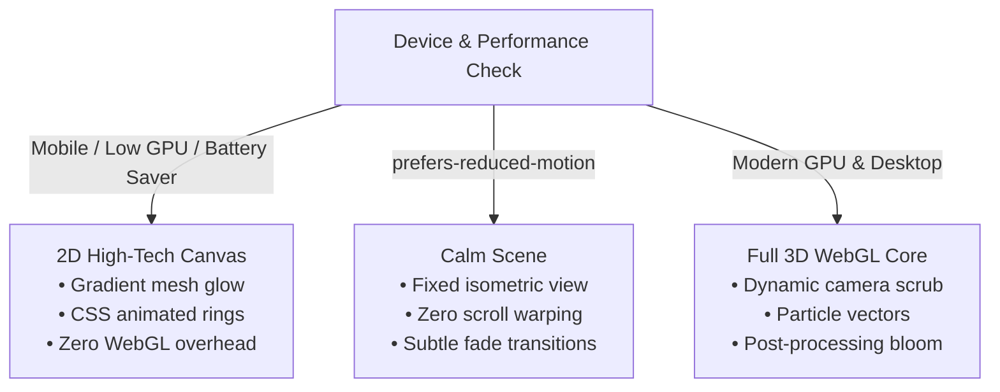

# SIFRA Website Blueprint & Technical Architecture

> **Project:** Official Website for SIFRA — Autonomous Local AI Research Workspace & Search API  
> **Repository Target:** `SIFRA-Website`  
> **Source Application Reference:** `https://github.com/codewitharnavx/SIFRA` (`C:\Users\Admin\.gemini\antigravity\scratch\sifra`)  
> **Author & Maintainer:** [@codewitharnavx](https://github.com/codewitharnavx)  
> **Status:** Architecture & Planning Phase (Deliverable)

---

## 1. Product Understanding & Deep Analysis

### 1.1 The Core Problem SIFRA Solves
Large Language Models running locally via runtimes like Ollama provide strong data privacy and zero inference costs. However, local LLMs operate under a critical handicap: **their knowledge is permanently frozen at training cutoff**. They cannot answer questions regarding recent framework versions, live web documentation, current events, or real-time data.

The industry standard solution has been to attach commercial cloud search APIs (Google Custom Search, Bing Web Search, Tavily, Perplexity). This introduces major barriers:
1. **Financial & Operational Friction:** Mandatory credit card entry, recurring subscription billing, strict API quotas, and credential management.
2. **Privacy Erosion & Data Leakage:** Every private research question, sensitive project idea, and document snippet is transmitted across third-party cloud corporate infrastructure.
3. **Fragility:** If an external search provider changes pricing, revokes API keys, or encounters downtime, private workflows break.

### 1.2 What SIFRA Is
**SIFRA** is an autonomous, locally hosted AI research workspace and self-hosted search API. It pairs an offline LLM (via **Ollama**) with a containerized metasearch engine (**SearXNG** in Docker) and a personal offline document database (**SQLite FTS5 with BM25 ranking**).

It delivers Perplexity-style, citation-backed factual synthesis running **100% on localhost** with zero required cloud API keys, zero subscriptions, and zero external data tracking.

```
┌────────────────────────────────────────────────────────────────────────┐
│                          SIFRA ARCHITECTURE                            │
├────────────────────┬────────────────────┬──────────────────────────────┤
│  Client Layer      │ Application Layer  │ Storage & Inference Layer    │
│  (React 18 + Vite) │ (Node.js Express)  │ (SearXNG + SQLite + Ollama)  │
│                    │                    │                              │
│  • Research UI     │ • Orchestrator     │ • SearXNG Docker (:8080)     │
│  • Citations [1]   │ • SSRF Crawler     │ • SQLite FTS5 BM25 Index     │
│  • Think Accordion │ • Hardware Monitor │ • Ollama Neural Daemon       │
│  • Model Modal     │ • Memory Agent     │ • GPU / VRAM Compute Engine  │
└────────────────────┴────────────────────┴──────────────────────────────┘
```

### 1.3 Key Architectural Pillars (from Source Inspection)
1. **Decoupled Metasearch Fan-Out (`searxngService.js`):** Interrogates 5 external search engines simultaneously (Google, DuckDuckGo, Bing, Wikipedia, GitHub) via an isolated local Docker container (`127.0.0.1:8080`), sanitizing trackers and normalizing JSON payloads.
2. **Dual-Index Retrieval & Algorithmic BM25 Ranking (`libraryService.js`):** Queries local SQLite `pages_fts` virtual table alongside web results, deduplicating records by canonical URL and scoring relevance.
3. **Hardware-Aware Model Intelligence (`hardwareService.js` & `recommendationService.js`):** Queries OS hardware (`nvidia-smi`, Windows CIM `Win32_VideoController`, ROCm, CPU/RAM) and classifies models into clear operational tiers:
   - 🟢 **Optimal (Full GPU):** Fits 100% into VRAM for low-latency inference.
   - 🟡 **Compatible (Hybrid):** Layer offloading between VRAM and system RAM.
   - 🔴 **Resource Intensive:** Exceeds recommended headroom; alerts user of CPU-bound paging.
4. **Autonomous Long-Term Memory Subsystem (`memoryService.js`):** Background extractor detects persistent user preferences and project context without user interruption, automatically sanitized against API keys/passwords, injecting durable context into future prompts.
5. **Polite Web Crawler with SSRF Defenses (`crawlerService.js`):** Safe indexing engine that parses `robots.txt`, enforces DNS resolution validation against private subnets/cloud metadata endpoints, and strips clutter with Cheerio.
6. **Dual Identity (Workspace UI + Developer REST API):** SIFRA serves both as an interactive research interface and as a headless JSON API (`/api/search`, `/api/research`, `/api/chat`) callable by local automation scripts and AI coding agents.

### 1.4 Features Deserving Prime Website Real Estate
* **Zero Cloud, Zero Subscriptions, Zero Leaks:** The foundational promise of privacy and independence.
* **The 5-Step Grounded Research Pipeline:** Visually demonstrating the flow from query to verified citations.
* **Hardware Detection & Model Tiers:** Showing real hardware awareness (RTX, Radeon, Apple Silicon, CPU).
* **Dual Retrieval (Live Web + Offline SQLite BM25):** The power of unified local documents and live web facts.
* **Think Mode & Verifiable Citations:** Collapsible reasoning traces and numbered source badges.
* **Developer Search API:** Ready-to-use cURL/Python integration for local agents.

---

## 2. Website Goals, Audience & Creative Direction

### 2.1 Primary Objectives
1. **Communicate Value in Seconds:** Immediately clarify that SIFRA provides Perplexity-grade grounded research without cloud API subscriptions or telemetry.
2. **Establish Engineering Authority:** Show real technical architecture, accurate hardware parameters, and actual screenshots instead of vague marketing promises.
3. **Drive Adoption & Community Engagement:** Direct developers, researchers, and homelab enthusiasts to the GitHub repository, quickstart guide, and self-hosted deployment scripts.

### 2.2 Target Audience
* **AI Developers & Engineers:** Building local agent workflows seeking a local search API without paying for Tavily/Bing.
* **Privacy-First Researchers & Knowledge Workers:** Analyzing sensitive internal data, proprietary code, or confidential topics.
* **Self-Hosters & Homelab Community:** Enthusiasts running Ollama, Docker, and local services who value offline independence.

### 2.3 Visual & Stylistic Language
* **Design Philosophy:** Minimalist High-Tech. Quiet chrome, dark depth, razor-sharp typography, and purposeful illumination.
* **Color System:**
  * **Midnight Abyss (Primary Background):** `#070A12` (dominant base), `#0B0F19` (elevated card background), `#111827` (borders/dividers).
  * **Electric Cyan (Active Accent):** `#00F0FF` (energy, glowing status, primary CTA highlight), `#00B8D4` (hover/secondary).
  * **Stark White (Primary Typography):** `#FFFFFF` (headings, high-contrast values).
  * **Muted Slate & Cool Grey (Secondary Typography & Chrome):** `#94A3B8` (body copy, descriptions), `#64748B` (inactive states, subtle labels).
* **Typography:**
  * **Display & Headings:** `Plus Jakarta Sans` or `Space Grotesk` (clean, technical, commanding, geometric).
  * **Body & UI:** `Inter` or `Geist Sans` (neutral, ultra-legible, high x-height).
  * **Data & Code:** `JetBrains Mono` or `Fira Code` (endpoints, timing metrics, parameter tags).

---

## 3. The 3D Storytelling Concept: "The Autonomous Core"

Rather than multiple disconnected 3D gimmicks, the website will feature **one continuous, evolving 3D scene (The Autonomous Core)** rendered in a fixed-position WebGL canvas behind the page content. As the user scrolls through the narrative, the Core smoothly transitions between distinct spatial and structural states via camera choreography and shader modulation.

```
Scroll Progress: 0% ────────────► 35% ────────────► 70% ────────────► 100%
Visual State:    [The Core]       [The Barrier]    [The Engine]     [The Monolith]
Concept:         Autonomous Hub   Air-Gapped Wall  Metasearch Grid  Terminal Portal
```

### 3.1 The 4 Evolving States of the Core

#### State 1: The Sovereign Node (Hero Section)
* **Visual:** A glowing, suspended geometric dodecahedron / neural sphere composed of electric cyan wireframe filaments and a dark refraction glass core. Gentle idle rotational drift.
* **Symbolism:** Represents the local machine—self-contained, private, quiet, and complete.
* **Interaction:** Cursor hover causes subtle magnetic surface ripple and light refraction.

#### State 2: The Air-Gap Shield (Problem & Privacy Section)
* **Visual:** As user scrolls to "The Problem", the camera pulls back slightly. The Core activates an orbital defensive shield composed of rotating concentric rings and particle vectors that deflect outward red/amber stray particles.
* **Symbolism:** Depicts SIFRA’s total barrier against cloud telemetry, tracking cookies, and unauthorized external data transmission.

#### State 3: The Metasearch & BM25 Constellation (How It Works & Pipeline)
* **Visual:** The Core unfolds. Orbiting nodes emerge in 3 distinct rings:
  1. The Outer Ring: 5 satellite nodes pulsing data pulses (DuckDuckGo, Google, Bing, Wikipedia, GitHub).
  2. The Inner Cylinder: Structured grid layers representing SQLite FTS5 BM25 document strata.
  3. The Core Focus: Filaments converge into the central Ollama model, illuminating with golden/cyan energy pulses as citations generate.
* **Symbolism:** The transparent, multi-stage retrieval and synthesis pipeline in action.

#### State 4: The Hardware Monolith (Architecture & Closing)
* **Visual:** The nodes re-dock into an ultra-dense, polished microchip monolith etched with bus circuits and hardware conduits (VRAM, CUDA, Tensor cores).
* **Symbolism:** Grounded physical performance running directly on host silicon.

---

## 4. Complete Landing-Page Structure (Section by Section)

```
┌─────────────────────────────────────────────────────────────┐
│ [Fixed Navigation Bar: Logo | Pipeline | Features | Docs | GitHub] │
├─────────────────────────────────────────────────────────────┤
│ 1. HERO — The Autonomous Intelligence Era                   │
│    Headline, Subtitle, Dual CTAs, Live Metric Ticker         │
├─────────────────────────────────────────────────────────────┤
│ 2. THE PROBLEM — The Trapped Intelligence Dilemma           │
│    The Cloud Tax vs. The Frozen Model                       │
├─────────────────────────────────────────────────────────────┤
│ 3. INTRODUCING SIFRA — The Private Research Workspace       │
│    Four Pillars in Harmonious Local Orchestration            │
├─────────────────────────────────────────────────────────────┤
│ 4. HOW IT WORKS — The 5-Stage Synthesis Pipeline            │
│    Interactive Step-by-Step Flow with Real Query Trace       │
├─────────────────────────────────────────────────────────────┤
│ 5. CORE CAPABILITIES — Dual-Pillar Feature Matrix           │
│    Local AI Intelligence + Advanced Retrieval Systems       │
├─────────────────────────────────────────────────────────────┤
│ 6. THE INTERFACE IN ACTION — Verified Experience            │
│    Real Screenshot Showcase with Interactive Detail Modals   │
├─────────────────────────────────────────────────────────────┤
│ 7. HARDWARE & REST API — Built for Builders & Agents        │
│    Hardware Recommendation Tiers & Copyable REST Endpoints   │
├─────────────────────────────────────────────────────────────┤
│ 8. PRIVACY GUARANTEE & DEPLOYMENT — Zero Leaks              │
│    Air-Gapped Comparison Table & 1-Line Setup Script        │
├─────────────────────────────────────────────────────────────┤
│ 9. CLOSING & FOOTER — Take Control of Your Research         │
│    Direct GitHub Star CTA, Documentation Link, Credits       │
└─────────────────────────────────────────────────────────────┘
```

### Detailed Section Breakdown

#### Section 1: Hero — The Sovereign Research Engine
* **Headline:** "Autonomous Research. Grounded by the Web. Bound to Your Machine."
* **Sub-headline:** "SIFRA combines local LLMs, self-hosted SearXNG metasearch, and an offline SQLite knowledge base into a private research workspace and developer search API. Zero cloud subscriptions. Zero telemetry."
* **Primary CTAs:**
  * `[ Get Started on GitHub ]` (Electric cyan button, links to repo)
  * `[ Explore the Architecture ↓ ]` (Ghost button with subtle cyan border)
* **Hardware & Status Bar:** A live floating chip below CTAs:
  * `● 100% Localhost` | `● SearXNG Metasearch Active` | `● Ollama Connected` | `● Zero External API Keys Required`

#### Section 2: The Problem — The Intelligence Dilemma
* **Narrative:** The modern researcher faces an artificial compromise.
* **Visual Representation (Two-Column Comparison Card):**
  * **Column A (The Cloud Cloud Trap):** Paid API keys, \$20/month per-seat fees, prompt telemetry stored on external servers, rate-limit throttling.
  * **Column B (The Frozen Local LLM):** 100% private, but stuck in the past. Hallucinates current libraries, unaware of today's documentation or news.
* **The SIFRA Breakthrough:** A single highlight card bridging the gap: *Full live web intelligence + complete local privacy.*

#### Section 3: Introducing SIFRA — The Four Pillars
* **Grid Layout:** 4 interactive glassmorphic cards surrounding the central 3D core:
  1. **Self-Hosted SearXNG:** Parallel metasearch across DuckDuckGo, Google, Bing, Wikipedia & GitHub inside Docker.
  2. **Offline SQLite BM25 Index:** Local web library indexed with FTS5 for sub-millisecond offline retrieval.
  3. **Local Neural Inference:** Native Ollama orchestration with dynamic context sizing and GPU acceleration.
  4. **Autonomous Memory Agent:** Background extraction of durable project context and developer preferences without credentials leakage.

#### Section 4: How It Works — The 5-Stage Synthesis Pipeline
* **Interactive Step Scroller:** As user scrolls, the active stage highlights with timing telemetry from real runs:
  1. **Context Analysis & Query Disambiguation:** Resolves conversational pronouns and detects intent (`web`, `local`, `both`).
  2. **Multi-Engine Fan-Out:** Queries dispatched simultaneously to Dockerized SearXNG and local SQLite FTS5.
  3. **Deduplication & BM25 Scoring:** Canonical URLs merged, tracking cookies stripped, candidate passages ranked.
  4. **Grounded Prompt Construction:** System rules, untrusted source snippets, and persistent memories combined.
  5. **Verified Synthesis with Citations:** Real-time generation with bracketed citations (`[1]`, `[2]`) linked to source cards.

#### Section 5: Core Capabilities — The Dual-Pillar Matrix
* **Pillar 1: Neural AI Innovations:**
  * **Think Mode:** Collapsible `<think>...</think>` accordion rendering chain-of-thought traces.
  * **Deep Research Mode:** Expands candidate pool to 8 sources and 6 deep passages for comprehensive analysis.
  * **AI Prompt Enhancer:** Autonomously restructures vague prompts into rigorous research briefs.
  * **Mathematical & Code Precision:** Full KaTeX LaTeX rendering and PrismJS syntax highlighting.
* **Pillar 2: Search & Storage Engineering:**
  * **Three Search Modes:** Live web, offline library, or unified hybrid.
  * **Polite SSRF Crawler:** Cheerio-based crawler with DNS validation against private IPs.
  * **Offline Mode:** Seamlessly operates in zero-internet environments querying the SQLite repository.

#### Section 6: Product Experience — Real Interface Showcase
* **Visual Anchor:** High-resolution screenshots from `sifra/docs/assets/` displayed in an interactive carousel with zooming and hotspot annotations:
  1. `hero-welcome-screen.png`: The minimal dark workspace, model indicator, and hardware badges.
  2. `chat-citations.png`: Real-time synthesis showing inline citations and linked source inspection cards.
  3. `chat-conversation-view.png`: Multi-turn research thread with Markdown and code rendering.
  4. `hardware-model-modal.png`: Real-time GPU detection and tier-based model recommendations.
  5. `memory-modal.png`: Autonomous memory dashboard with category tags and manual override controls.

#### Section 7: Technology & Developer Search API
* **Two Sub-modules:**
  * **Sub-module A: Hardware Intelligence Engine:** Explains how SIFRA inspects GPU VRAM and categorizes models into *Optimal*, *Compatible*, and *Resource-Intensive* tiers.
  * **Sub-module B: Headless Developer API:** An interactive code switcher (cURL, Python, Node.js) demonstrating that SIFRA is also a drop-in local search API for autonomous coding agents.
    ```bash
    curl -X POST http://localhost:5000/api/search \
      -H "Content-Type: application/json" \
      -d '{"query": "React 19 Server Actions", "mode": "both", "limit": 5}'
    ```

#### Section 8: Privacy & Deployment Architecture
* **The Zero-Leak Comparison Table:** Side-by-side verification: SIFRA vs. Cloud Search APIs vs. Standard Chatbots (metrics: API Keys, Query Logging, Telemetry, Offline Operation, Subscription Cost).
* **One-Click Startup:** Highlighting the automated launcher scripts (`Start Sifra.bat` / `setup.sh`) that bring Docker, backend, and frontend online with readiness polling.

#### Section 9: Closing & Call to Action
* **Headline:** "Own Your Research. Run SIFRA Today."
* **Sub-text:** "Open-source, self-hosted, and free forever under the MIT License."
* **Actions:**
  * `[ Star on GitHub ★ ]`
  * `[ View Setup Documentation ]`
  * `[ Read Architecture Docs ]`
* **Footer:** Project version, created & maintained by `@codewitharnavx`, MIT License statement.

---

## 5. Technical Architecture & Stack Evaluation

### 5.1 Technology Recommendations

| Category | Recommended Technology | Justification & Advantages |
| :--- | :--- | :--- |
| **Core Framework** | **React 18 + Vite** | Blazing fast HMR, matches the SIFRA application stack, zero bundle bloat, native ES module support. |
| **3D Rendering** | **Three.js + React Three Fiber (R3F) + Drei** | Industry standard for declarative, performant WebGL in React. Enables efficient shader passes and instance management. |
| **Scroll Choreography** | **GSAP + ScrollTrigger + Lenis** | Unrivaled timeline control. Connects smooth inertial scrolling (Lenis) directly to camera coordinates and 3D object rotation without frame stutter. |
| **Styling & Design Tokens** | **Tailwind CSS + CSS Custom Properties** | Rapid atomic styling, dark-mode native, easy token management for the Midnight Blue/Electric Cyan palette. |
| **Icons** | **Lucide React** | Consistent, modern geometric line icons matching both the SIFRA app and modern developer aesthetics. |
| **Typography** | **Plus Jakarta Sans + JetBrains Mono (via Google Fonts)** | High-character modern geometric sans-serif for headlines; ultra-readable monospace for API code blocks. |
| **Deployment** | **Vercel / GitHub Pages / Cloudflare Pages** | Static single-page application output (`vite build` to `dist/`), instantaneous global edge caching. |

### 5.2 Avoided Dependencies & Reasons
* ❌ **Full UI Component Libraries (MUI / Ant Design):** Massive bundle overhead, corporate design baggage that clashes with the futuristic aesthetic.
* ❌ **Framer Motion for 3D Camera:** Framer Motion is excellent for 2D DOM layout transitions, but lacks the sub-pixel scroll scrub performance of GSAP ScrollTrigger for 3D camera coordinate interpolations.
* ❌ **Heavy Spline Embeds:** External iframe or large runtime assets create loading lag and frame drops on lower-spec hardware; pure Three.js procedural geometry is far lighter and loads instantaneously.

---

## 6. Animation, Interaction & 3D Performance Strategy

### 6.1 The 3D Rendering Pipeline
* **Procedural Geometry:** The Autonomous Core will use procedural Three.js buffers (IcosahedronGeometry, LineSegments, Points cloud) instead of multi-megabyte GLTF models. Total 3D asset transfer size: **< 150 KB**.
* **Draw Call Minimization:** All floating orbital particles will use `InstancedMesh` with a single draw call.
* **Canvas Clamping:** Pixel ratio clamped strictly to `Math.min(window.devicePixelRatio, 2)` to protect high-density screens from GPU thermal throttling.

### 6.2 Low-Power & Mobile Fallback Strategy


1. **Hardware Tier Detection:** On mount, check GPU capability via WebGL context parameters and screen width.
2. **Reduced Motion Compliance:** Detect `(prefers-reduced-motion: reduce)`. If active, disable camera warping and inertial scrolling; replace with calm, standard opacity reveals.
3. **Mobile Simplification:** On viewports $< 768\text{px}$, disable heavy particle simulations and render an optimized lightweight 2D canvas background while preserving the full text narrative and screenshot gallery.

---

## 7. Asset & Screenshot Strategy

All visual materials will be sourced directly from the actual SIFRA codebase and documentation:

1. **`sifra/docs/assets/hero-welcome-screen.png`:** Featured in Section 6 to highlight the clean search composer and system status indicators.
2. **`sifra/docs/assets/chat-citations.png`:** Featured in Section 4 and Section 6 to prove verifiable inline citations and source domain tags.
3. **`sifra/docs/assets/hardware-model-modal.png`:** Featured in Section 7 to demonstrate the hardware detection engine and GPU tiering.
4. **`sifra/docs/assets/memory-modal.png`:** Featured in Section 3 and Section 6 illustrating autonomous memory management.
5. **`sifra/docs/assets/chat-conversation-view.png`:** Featured in Section 5 illustrating multi-turn research, code highlighting, and math formatting.

> **Asset Handling Rule:** All image assets will be copied into `SIFRA-Website/public/assets/` during the implementation phase. Original files in `sifra/docs/assets/` will remain completely unmodified.

---

## 8. SEO, Metadata & Accessibility Strategy

* **Page Title:** `SIFRA — Autonomous Local AI Research Workspace & Search API`
* **Meta Description:** `Grounded local AI research powered by Ollama, self-hosted SearXNG metasearch, and offline SQLite BM25 indexing. 100% localhost, zero cloud subscriptions, zero telemetry.`
* **OpenGraph & Twitter Card:** Custom preview card highlighting the Midnight/Cyan Core and tagline.
* **Semantic Hierarchy:** Strict document outline with one `<h1>`, sequential `<h2>` sections, and descriptive `aria-label` tags for all interactive modal triggers and code copy buttons.
* **Contrast Compliance:** All text conforms to WCAG AA contrast standards (minimum $4.5:1$ ratio against `#070A12`).

---

## 9. Implementation Roadmap & Phases

```
┌────────────────────────────────────────────────────────────────────────┐
│                        IMPLEMENTATION PHASES                           │
├───────────────┬────────────────────────────────────────────────────────┤
│ Phase 1       │ Project Scaffolding & Design Foundation                │
│ (Preparation) │ • Vite + React + Tailwind setup                        │
│               │ • Palette tokens, typography, asset staging            │
├───────────────┼────────────────────────────────────────────────────────┤
│ Phase 2       │ Core 3D Scene & Canvas Foundation                      │
│ (3D Engine)   │ • Three.js / R3F Canvas setup                          │
│               │ • Procedural Autonomous Core geometry & shaders        │
│               │ • Camera controller & state timeline hook              │
├───────────────┼────────────────────────────────────────────────────────┤
│ Phase 3       │ Narrative Sections & Typography Implementation         │
│ (Storytelling)│ • Sections 1 through 9 coded with semantic HTML        │
│               │ • GSAP ScrollTrigger timeline binding                  │
│               │ • Interactive API switcher & screenshot showcase       │
├───────────────┼────────────────────────────────────────────────────────┤
│ Phase 4       │ Responsiveness, Fallbacks & Motion Polish              │
│ (Hardening)   │ • Mobile 2D fallback & reduced-motion handling         │
│               │ • Performance auditing (60 FPS test, bundle size)      │
│               │ • Cross-browser verification                           │
└───────────────┴────────────────────────────────────────────────────────┘
```

---

## 10. Potential Technical Risks & Mitigation

| Potential Risk | Technical Impact | Engineering Mitigation |
| :--- | :--- | :--- |
| **WebGL Performance Lag on Integrated GPUs** | Dropped frames during fast scroll on low-end laptops. | Implement DPR clamp (`max: 1.5`), disable post-processing on weak devices, use procedural instancing, and offer a smooth 2D canvas fallback. |
| **Scroll Desynchronization between 3D & DOM** | 3D object jumps or lags behind HTML section copy. | Use Lenis smooth scrolling bound directly to GSAP's ticker (`gsap.ticker.add(lenis.raf)`), ensuring unified animation frames. |
| **Mobile Layout Cramping** | Complex 3D scene obscures mobile typography. | Shift canvas z-index behind text cards on mobile, reduce particle counts by 75%, and convert interactive 3D rotations into subtle ambient background motion. |
| **Over-reliance on Heavy Assets** | Slow initial page load. | Zero external 3D model files (GLTF/OBJ). Use pure procedural Three.js primitives and code-driven shaders; optimize screenshots via modern WebP format. |
